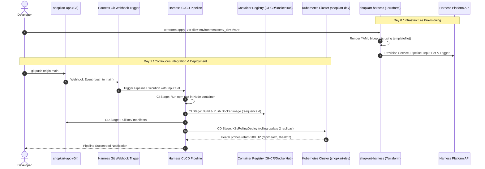

# ShopKart: Comprehensive DevOps & Harness Mentorship Project

Welcome to **ShopKart**, an enterprise-modeled DevOps learning environment designed to show how a production application repository connects to an independent Infrastructure as Code (IaC) repository managed via Harness and Terraform.

---

## 1. Project Map & Architecture

The workspace is organized into two distinct, decoupled repositories:

```text
Learning/
├── shopkart-app/             # APPLICATION REPOSITORY (Source Code & Manifests)
│   ├── frontend/             # Angular 22 Single Page Application (Standalone, Signals)
│   ├── backend/              # Node.js 22 Express REST API (/api/health, /api/products)
│   ├── docker/               # Multi-stage Dockerfiles & local Docker Compose
│   ├── k8s/                  # Kubernetes manifests (Namespace, Deployment, Service, Kustomize)
│   ├── .gitignore            # Git exclusion rules for application artifacts
│   └── README.md             # Application setup and run documentation
│
└── shopkart-harness/         # INFRASTRUCTURE AS CODE REPOSITORY (Harness Platform IaC)
    ├── _template_services/   # Blueprint for Harness Kubernetes Service & Artifact Source
    ├── _template_pipelines/  # Blueprint for CI/CD Pipeline (Build, Test, K8s Rolling Rollout)
    ├── _template_input_set/  # Blueprint for Pipeline Input Sets (Image tags, Environment)
    ├── _template_trigger/    # Blueprint for Webhook Git Triggers
    ├── environments/         # Environment parameter files (env_dev.tfvars)
    ├── modules/              # Reusable Terraform modules (services, pipelines, input-sets, triggers)
    ├── resources/            # Architecture reference configs (sample Harness connectors)
    ├── demo-*.tf             # Root Terraform resources rendering templates via templatefile()
    ├── variables.tf          # Terraform variable definitions with validation rules
    ├── versions.tf           # Terraform & official Harness provider versions
    ├── providers.tf          # Provider setup (API endpoint, account, and credentials)
    ├── outputs.tf            # Exposed resource IDs & fully rendered YAML definitions
    ├── .gitignore            # Excludes Terraform state files and credentials
    └── README.md             # Harness IaC setup, state management, and execution guide
```

---

## 2. End-to-End Delivery Flow



---

## 3. Quickstart: Local Verification Commands

### Step 1: Verify & Test Backend
```powershell
cd Learning/shopkart-app/backend
npm test
```
*Expected: 7/7 tests pass (health check, product catalog, category filters, cart calculations, 404 handler).*

### Step 2: Verify & Build Frontend
```powershell
cd Learning/shopkart-app/frontend
npm run build
```
*Expected: Angular production bundle compiles cleanly into `dist/frontend/browser`.*

### Step 3: Validate Kubernetes Manifests
```powershell
cd Learning/shopkart-app
kubectl kustomize k8s/
```
*Expected: Outputs clean YAML for Namespace, ConfigMap, Deployments, and Services in `shopkart-dev`.*

### Step 4: Validate Harness Terraform Configuration
```powershell
cd Learning/shopkart-harness
terraform validate
terraform plan -var-file="environments/env_dev.tfvars"
```
*Expected: 4 resources planned to add, 12 outputs computed (including fully rendered pipeline YAMLs).*

---

## 4. Mentor Notes: Real-World Lessons

1. **Decoupled Repositories**: In large organizations, application developers frequently push to `shopkart-app`, while central Platform Engineering or DevOps teams manage `shopkart-harness`. Decoupling prevents merge conflicts and enforces strict security boundaries.
2. **Templatefile Escaping**: Harness expressions use `<+...>` or `${...}`. To prevent Terraform's `templatefile()` parser from mistaking literal Harness variables for Terraform variables, prefix literal `${...}` with a second dollar sign (`$${...}`).
3. **Child Module Provider Requirement**: Every Terraform child module using a third-party provider like `harness/harness` must declare a `required_providers` block; otherwise, Terraform defaults to looking up `hashicorp/harness`, which causes initialization failures.
4. **State Protection**: Never commit `terraform.tfstate` or `.tfplan` files to version control. They can expose sensitive tokens and lead to destructive state locking conflicts.
