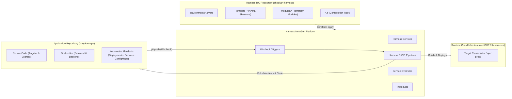
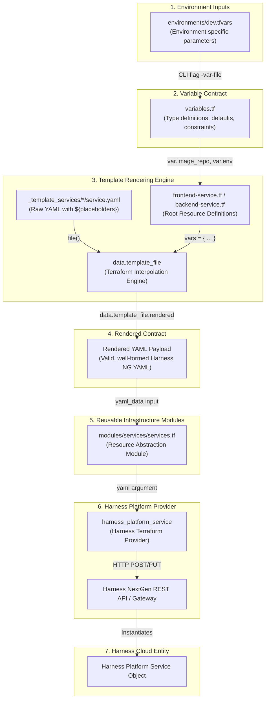
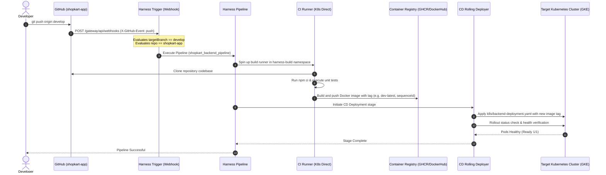
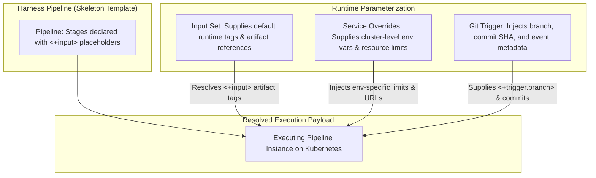

# Enterprise Architecture & End-to-End Data Flow

This document details the architectural blueprint and operational data flow of the **ShopKart Harness + Terraform** repository (`shopkart-harness`).

It bridges the conceptual gap between:
1. **Terraform Infrastructure as Code (IaC)** provisioning declarative configuration into the Harness Platform.
2. **Harness Platform Runtime Execution (CI/CD)** automating application build, containerization, and rollout to Kubernetes.

---

## 1. Architectural Overview & Separation of Concerns

In modern enterprise DevOps, infrastructure repositories and application repositories operate independently:



### Key Distinction: Provisioning vs. Execution
* **Terraform Provisioning (Day 0 / Day 1):** Terraform provisions the Harness entities: it registers the Services, establishes the Pipelines, configures the Webhook Triggers, attaches Input Sets, and applies Environment Overrides. It does **not** deploy application containers.
* **Harness Pipeline Execution (Day 2):** When a developer pushes code to GitHub, GitHub fires a webhook. The Harness Trigger catches this event, executes the pre-provisioned Pipeline, builds the Docker image, and executes a rolling rollout to Kubernetes.

---

## 2. End-to-End Terraform Data Flow

Data flows through a structured, multi-tier pipeline in Terraform before reaching the Harness Platform API:



---

## 3. Deep Dive: The Template Rendering Mechanics

### Why Enterprises Use YAML Templates in Terraform
In Harness, complex entities (Pipelines, Services, Triggers) are defined natively in YAML. Rather than attempting to represent thousands of lines of deeply nested YAML structures as native HCL blocks, enterprise organizations store clean, version-controlled YAML templates in `_template_*` directories and inject dynamic values using Terraform.

### The `data.template_file` vs `templatefile()` Evolution
1. **`data.template_file` (Legacy / Enterprise Standard):**
   - Originally part of `hashicorp/template`.
   - Uses data source lifecycle:
     ```terraform
     data "template_file" "frontend_pipeline_tmpl" {
       template = file("${path.module}/_template_pipelines/frontend-pipeline/pipeline.yaml")
       vars = {
         service_identifier = module.frontend_service.identifier
         environment        = var.environment
       }
     }
     ```
   - **Why large enterprises still use it:** Many enterprise governance frameworks, CI/CD runners, and internal wrappers were architected around data sources and graph dependencies.
   - **Important Syntax Note:** In `data.template_file`, literal bash variables in scripts (e.g. `$${BUILD_ID}`) must use double dollar signs (`$$`) to prevent Terraform interpolation errors.
2. **`templatefile()` (Modern Built-in):**
   - Introduced in Terraform 0.12 as a native function, removing the need for an external provider.
   - `service_yaml = templatefile("path", { vars })`

---

## 4. Frontend vs. Backend Deployment Architecture

ShopKart separates Frontend and Backend configurations to ensure independent deployment lifecycles, zero-downtime rollouts, and distinct security boundaries.

| Architectural Dimension | Frontend Service (`frontend-*`) | Backend Service (`backend-*`) |
| :--- | :--- | :--- |
| **Technology Stack** | Angular SPA (Nginx container) | Node.js / Express.js REST API |
| **Port** | `80` (HTTP) | `5000` (API) |
| **CI Build Stage** | `npm ci` & `ng test` / ChromeHeadless | `npm ci` & Mocha/Jest unit tests |
| **Docker Build** | `docker/Dockerfile.frontend` | `docker/Dockerfile.backend` |
| **Service Overrides** | Replica count, CDN endpoints, API URLs | Database URIs (MongoDB Atlas), connection pools, secret tokens |
| **Rollout Strategy** | Rolling deploy, immediate cache busting | Rolling deploy with database connectivity smoke test |

---

## 5. Webhook-Driven CI/CD Execution Flow

When a developer works on application code in `shopkart-app`:



---

## 6. How Environment Promotion Works (`dev` -> `qa` -> `prod`)

Promotion across environments does **not** alter the core pipeline or service architecture. It only swaps the parameter values supplied via `.tfvars`:

```bash
# 1. Plan for Development
terraform plan -var-file="environments/dev.tfvars"

# 2. Plan for QA / Staging
terraform plan -var-file="environments/qa.tfvars"

# 3. Plan for Production
terraform plan -var-file="environments/prod.tfvars"
```

### Impact of Environment Swapping:
1. **Target Cluster:** `k8s_connector_ref` switches from `account.kubernetes_dev_cluster` to `account.kubernetes_prod_cluster`.
2. **Namespace & Isolation:** Deployments land in dedicated environment namespaces (`dev`, `qa`, `prod`).
3. **Resource Allocations:** Pod memory limits increase from `256Mi` in Dev to `1Gi` in Prod; CPU limits scale from `250m` to `1000m`.
4. **Replication & High Availability:** Prod spins up 4 backend pods and 3 frontend pods; Dev operates with single replicas to conserve cluster cost.
5. **Observability:** `backend_log_level` shifts from verbose `debug` in Dev to optimized `warn` in Prod.
6. **Data Storage:** Backend binds to isolated internal test databases in Dev/QA and connects to managed MongoDB Atlas clusters in Prod.

---

## 7. Triggers, Input Sets, and Overrides Integration



* **Pipeline Skeleton:** Leaves environment-variable bindings and artifact tags as `<+input>`, making the pipeline generic and reusable across all stages.
* **Input Sets (`inputset.yaml`):** Store concrete runtime parameters for specific deployment targets without hardcoding values into the pipeline.
* **Service Overrides (`override.yaml`):** Adjust environment-specific variables (such as memory limits, replica counts, and ConfigMap values) dynamically when the service is deployed to a given environment.
* **Webhook Triggers (`trigger.yaml`):** Intercept GitHub events, inject runtime payload variables (`<+trigger.branch>`), and launch the pipeline automatically.
